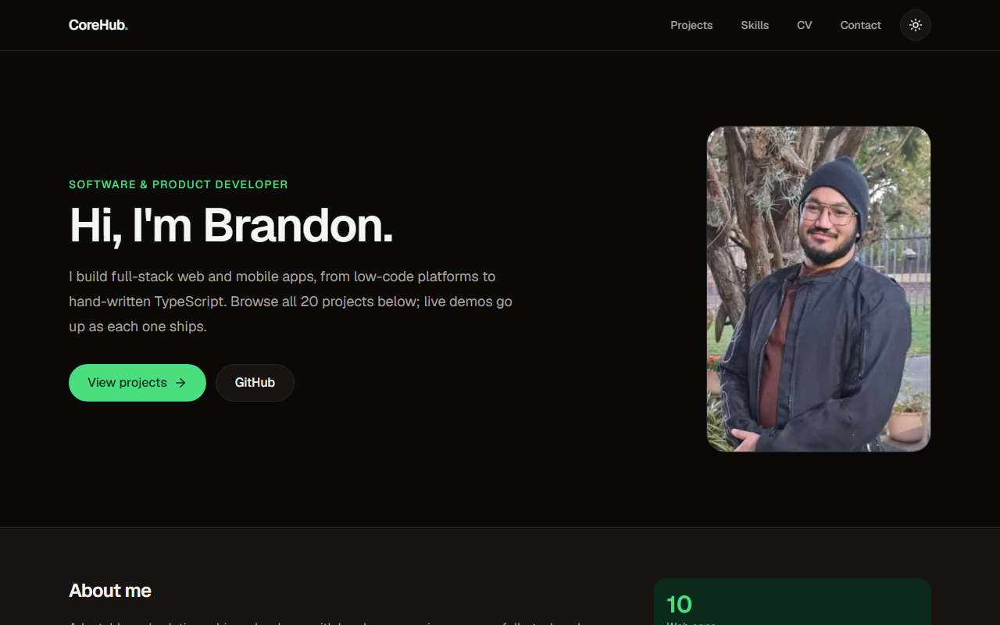

# CoreHub

The front door to my developer portfolio: 20 web and mobile apps with live demos, screenshots and architecture notes, plus a CV viewer with PDF download, an interactive skills matrix and a contact form.

**Live demo:** https://branprojects.netlify.app



## What to demo to a recruiter

1. **The project grid.** Filter all 20 projects by web or mobile and by technology. Open any card for screenshots, the stack, a "what to demo" list and architecture notes, then jump straight to its live demo or code.
2. **The CV page.** Read my CV on screen and use **Download PDF** for a clean, print-styled copy that always prints in light colours.
3. **The skills matrix.** Filter by frontend, backend, data and tooling. Each skill links to the projects that use it.

## Features

- Home with hero, about section and a filterable project grid driven by one typed data file
- Project detail pages with screenshots, stack, "what to demo" bullets and architecture notes
- CV page with print-to-PDF export
- Interactive skills matrix with links to the projects that use each skill
- Contact form (Netlify Forms) with a honeypot for spam protection
- Dark and light themes, `prefers-reduced-motion` respected, keyboard accessible
- SEO: per-page metadata, Open Graph image, `sitemap.xml` and `robots.txt`
- Links only appear once an app is deployed; everything else shows "Coming soon"

### Phase 2

- Blog and case studies (MDX)
- Embedded live-demo iframes where the apps allow it
- Privacy-friendly analytics
- Stronger contact-form spam protection if needed

## Stack

Next.js 16 (App Router, Cache Components) · React 19 · TypeScript (strict) · Tailwind CSS 4 · Framer Motion · lucide-react · Netlify (hosting and Forms) · Playwright (screenshot capture script only)

## Architecture notes

- **One source of truth.** Every project lives in `data/projects-web.ts` and `data/projects-mobile.ts` and is typed by the `Project` interface in `types/`. The grid, detail pages, sitemap and skills links are all generated from that data, so shipping an app is a one-line change.
- **No fake links.** `liveUrl` and `repoUrl` are `null` until an app is deployed, and the UI shows "Coming soon" instead.
- **Static where possible.** Detail pages are prerendered with `generateStaticParams`; client components are limited to the interactive pieces (theme toggle, hero animation, grid and skills filters, print button and contact form).
- **Contact form without a backend.** A hidden static copy of the form (`public/__forms.html`) lets Netlify detect it at build time; the React form posts to it with `fetch`. A honeypot field catches bots, and failures fall back to a visible email address.
- **Print-styled CV.** The CV is a normal page; print CSS hides the site chrome and forces light colours, so the browser's "Save as PDF" produces a clean document with no extra dependency.
- **Screenshots.** Stored locally under `public/screenshots`, never hotlinked. `scripts/capture.mjs` captures desktop and 375px phone views of a live app with Playwright.

## Run locally

```bash
npm install
npm run dev        # http://localhost:3000
```

No environment variables are required. Other scripts: `npm run build`, `npm run lint`.

To capture screenshots of a live app (from Git Bash on Windows, prefix with `MSYS_NO_PATHCONV=1`):

```bash
npx playwright install chromium
OUT=./out node scripts/capture.mjs https://example.netlify.app my-app / /another-page
```

## Deploying

Connected to GitHub on Netlify: every push to `main` builds with `npm run build` and redeploys. After deploying, add a notification email under **Forms → Form notifications** so contact messages reach an inbox.

## Status

Live. Project links and screenshots are added as each app ships.
